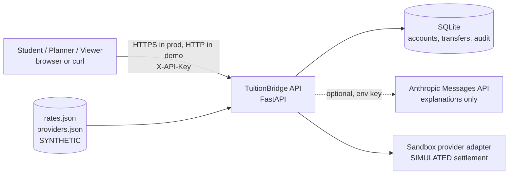
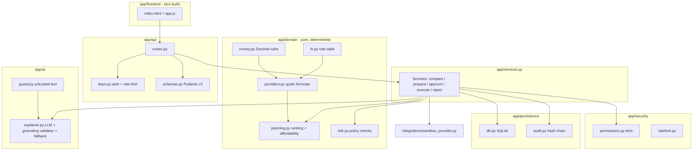
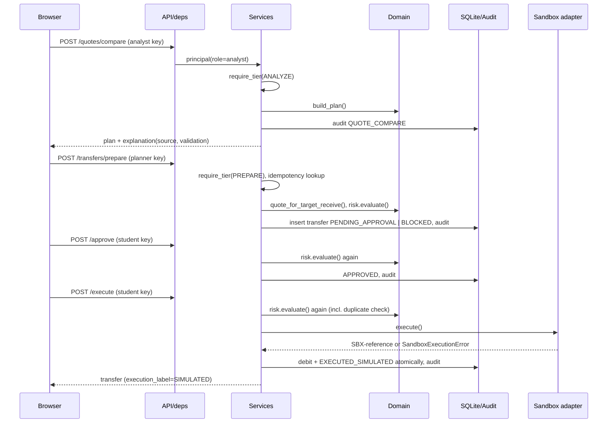
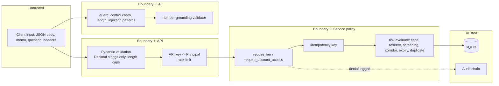
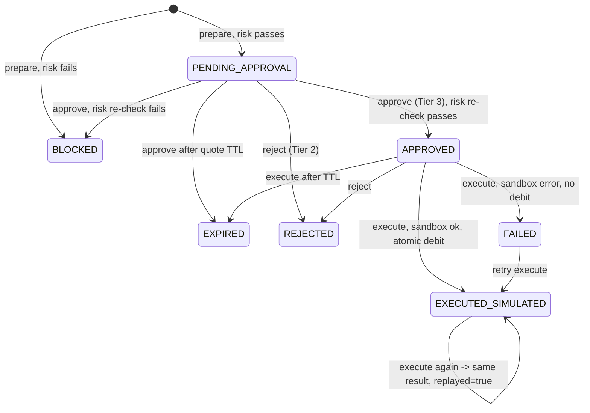
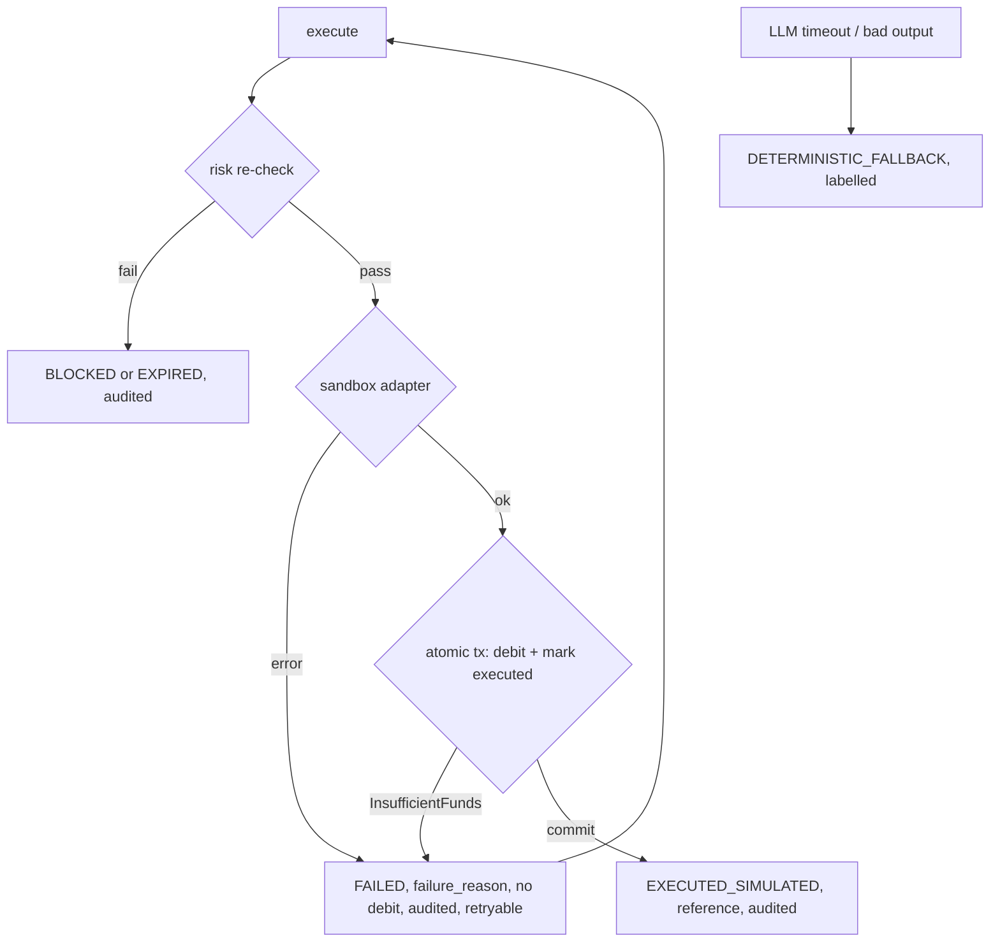

# System architecture

All diagrams describe the implemented code in `app/`. Nothing shown here is planned-only.

## 1. System context


## 2. Components


## 3. Runtime sequence (happy path)


## 4. Trust boundaries and permission enforcement

Tier 4 (`PRODUCTION`) is a constant `PRODUCTION_TIER_ENABLED = False`; `require_tier` raises before role evaluation.

## 5. Transfer state machine


## 6. Data model
```mermaid
erDiagram
  ACCOUNTS ||--o{ BALANCES : has
  ACCOUNTS ||--o{ BENEFICIARIES : owns
  ACCOUNTS ||--o{ TRANSFERS : initiates
  TRANSFERS }o--|| BENEFICIARIES : pays
  AUDIT_LOG }o--o| ACCOUNTS : about
  ACCOUNTS { text id PK; text holder_name; text home_currency; text reserve_min; text institution }
  BALANCES { text account_id FK; text currency; text amount }
  BENEFICIARIES { text id PK; text account_id FK; text currency; text account_number_masked; int blocked; text simulate_failure }
  TRANSFERS { text id PK; text idempotency_key; text status; text quote_json; text risk_json; text quote_expires_at; text amount_usd_equiv; text provider_reference }
  AUDIT_LOG { int seq PK; text ts; text actor; text action; int tier; text payload_json; text prev_hash; text hash }
```
Money columns are decimal strings; `(account_id, idempotency_key)` is unique.

## 7. Integration architecture
Only two external interfaces exist: the sandbox provider adapter (in-process, deterministic, labelled SIMULATED, with injectable failure modes) and the optional Anthropic Messages API for explanations (timeout, exception → fallback). Rates and providers are file fixtures loaded at startup.

## 8. Deployment
Single process: `uvicorn app.asgi:app`. Configuration via environment or `.env` (`.env.example`). SQLite file auto-created and seeded. Frontend is static files mounted by FastAPI; no build step. For production the documented constraints are: TLS termination, real identity provider instead of API keys, KMS-held secrets, a server database, external anchoring of the audit head hash.

## 9. Failure and recovery

